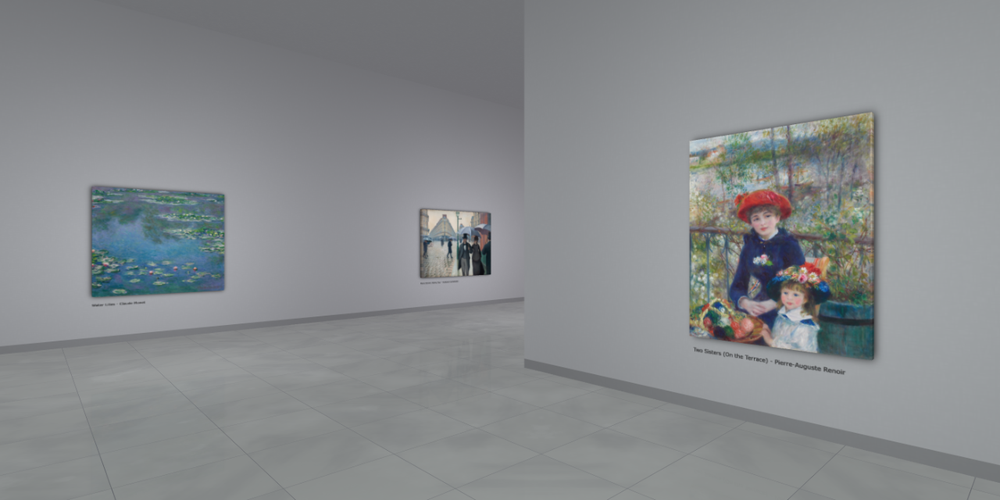

# [Virtual Art Gallery](https://clementcariou.github.io/virtual-art-gallery/build) [](https://github.com/ClementCariou/virtual-art-gallery/actions/workflows/build-and-deploy.yml)

[](https://clementcariou.github.io/virtual-art-gallery/build)

## Description

This project simulates an art gallery in your browser using [REGL](https://github.com/regl-project/regl).
It aims at reproducing the experience of a real art gallery.
The architecture is generated using a 10km long 6th order [Hilbert Curve](https://en.wikipedia.org/wiki/Hilbert_curve).
The paintings are asynchronously loaded from the [ARTIC](https://api.artic.edu) and placed on the walls.
You can use this project to display your own artworks.

## Setup

Installation :
```shell
git clone https://github.com/ClementCariou/virtual-art-gallery.git
npm install
```
Start the budo dev server : 
```shell
npm start
```
Build : 
```shell
npm build
```

## Using it with [local images](https://clementcariou.github.io/virtual-art-gallery/build?api=local)

The local api is accessible using this URI params in the address bar: ```?api=local``` (it's possible to load automatically this API by changing the default API in the [api.js](api/api.js) file). You can change the displayed images in the folder [images](images), you will need to rebuild the project (or relaunch the dev server) to apply the modifications.

## Live on-chain art

Some collections carry the artwork itself as an HTML document (a `data:text/html` URI in the
CIP-25 `files[]`), not only a still cover. For a `?source=collection:<policy>` or
`?source=listed:<policy>` walk, the renderer asks the gallery worker for each visible piece's
document at `/gallery/art?policy=<policy>&name=<asset_name_hex>`. When one exists, an iframe is
composited over the painting's projected quad with a CSS `matrix3d` homography, so the live
piece tracks the camera, perspective and wall angle. A `204` means the piece is an ordinary
still and the cover stays up.

- The overlay is display-only (`pointer-events: none`) and sandboxed with `allow-scripts` only.
- At most four of the largest visible live pieces are mounted at once; the rest keep their cover,
  because each mounted document is its own animation loop.
- A piece whose centre is behind a wall is unmounted. A wall that cuts across a partially
  visible piece is projected into a screen-space `clip-path`, so the iframe is cut away where
  the wall occludes it instead of painting over the wall.
- Reflections still show the WebGL cover, and a listed piece's WebGL price tag sits under the
  iframe. Both are known first-pass limits.

The endpoint lives in `cnft.dev-workers` (`workers/gallery`), which proxies collection-ownership's
`/api/art/:policy/:asset_name_hex`. The standalone dev server does not have it, so live art is
inert under `npm start` unless the request is mocked.
